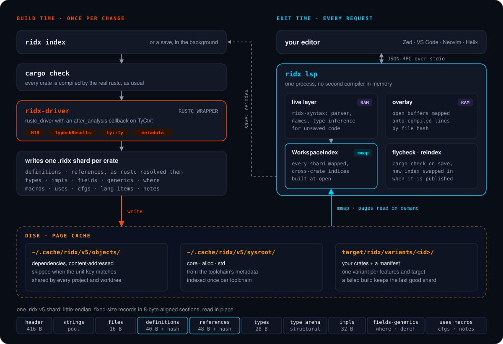

<!-- translation-source: 272031158e380b3c990769ad55301f4df78c5f1d -->

> [!NOTE]
> 本文是英文 README 在提交 [2720311](https://github.com/alex09x/rust-intelligence/blob/272031158e380b3c990769ad55301f4df78c5f1d/README.md) 时的翻译。权威且最新的版本是[英文 README](https://github.com/alex09x/rust-intelligence/blob/main/README.md)。

<p align="center">
  
</p>

<h1 align="center">Rust Intelligence (<code>ridx</code>)</h1>

<p align="center">
  <b>只用十分之一内存的 Rust 代码智能。</b><br>
  一个 Rust 语言服务器，直接使用 rustc 已经算出的结果来回答。
</p>

<p align="center">
  <a href="https://rust-intelligence.com"></a>
  
  
  
  <a href="https://doi.org/10.5281/zenodo.24379816"></a>
</p>

<p align="center">
  <a href="https://github.com/alex09x/rust-intelligence/blob/main/README.md">English</a> ·
  <a href="https://github.com/alex09x/rust-intelligence/blob/main/readme/README.ru.md">Русский</a> ·
  <b><a href="https://github.com/alex09x/rust-intelligence/blob/main/readme/README.zh-CN.md">简体中文</a></b> ·
  <a href="https://github.com/alex09x/rust-intelligence/blob/main/readme/README.es.md">Español</a> ·
  <a href="https://github.com/alex09x/rust-intelligence/blob/main/readme/README.pt-BR.md">Português (Brasil)</a> ·
  <a href="https://github.com/alex09x/rust-intelligence/blob/main/readme/README.ja.md">日本語</a> ·
  <a href="https://github.com/alex09x/rust-intelligence/blob/main/readme/README.de.md">Deutsch</a> ·
  <a href="https://github.com/alex09x/rust-intelligence/blob/main/readme/README.fr.md">Français</a> ·
  <a href="https://github.com/alex09x/rust-intelligence/blob/main/readme/README.ko.md">한국어</a> ·
  <a href="https://github.com/alex09x/rust-intelligence/blob/main/readme/README.ar.md">العربية</a>
</p>

`ridx` 在 `cargo check` 期间一次性把定义、引用和类型记录到二进制索引中，并直接从磁盘读取该索引。
编辑器由此获得跳转、悬停提示、补全、查找引用和重命名，而无需在内存中常驻第二个编译器。

支持 Linux 和 macOS。本项目与 Rust Project 和 Rust Foundation 无关联。

---

## 为什么

- **rust-analyzer 在内存中保存它对整个工作区的分析**：在下面的测量中，serde 为 1.5 GB，
  Bevy 为 11.3 GB。它重复了 rustc 在每次 `cargo check` 时本来就会做的名称解析、宏展开和类型推断。
- **被分析的大部分代码是依赖和 std**，没有人会去编辑。`ridx` 每个依赖只索引一次，
  并在本机所有项目和 worktree 之间共享。
- **正在输入的代码同样可用**：未保存的修改由索引之上的内存覆盖层立即回答；最后一次修改 250 ms 后，被修改的
  crate 会从缓冲区编译进会话索引，因此引用和重命名也能看到新代码。其中的编译器错误也会被报告。

## 测量

对两个服务器运行同一个编辑器会话：逐个打开每个仓库的 40 个文件，请求文档符号、语义高亮、折叠、
inlay 提示，然后在抽样位置请求悬停、跳转到定义、跳转到类型定义、文档高亮、引用和补全，并进行一次编辑。
内存包含子进程。

| 仓库 | 峰值内存，ridx / rust-analyzer | 会话 CPU 时间 | 从启动到就绪 |
|---|---:|---:|---:|
| serde | 72 MB / 1.5 GB | 2.34 s / 6.97 s | 0.06 s / 3.27 s |
| tokio | 221 MB / 3.2 GB | 1.90 s / 35.9 s | 0.24 s / 4.77 s |
| rust-analyzer | 434 MB / 4.6 GB | 4.44 s / 66.7 s | 0.64 s / 5.22 s |
| bevy | 917 MB / 11.3 GB | 5.38 s / 170.5 s | 1.26 s / 15.5 s |

- ridx `f7105fcc`，2026-11-14；在 Linux 6.8、AMD Ryzen 9 7950X、64 GB 上运行一次（n = 1）。原始结果：
  [`bench/published/resources_f7105fcc.jsonl`](../bench/published/resources_f7105fcc.jsonl)，脚本：
  [`bench/measure_resources.py`](../bench/measure_resources.py)；各方法的延迟见原始结果和网站。
- **未计入**：ridx 从预先构建的索引回答（`ridx index`，即带 ridx 驱动的 `cargo check`），
  在大型工作区上首次构建需要几分钟。rust-analyzer 每次启动都会分析工作区，这段时间计入了它的数字。
- **“就绪”** 对 ridx 指对 `initialize` 的回复（之后缓存在后台继续预热），对 rust-analyzer
  指其分析结束再加 0.5 s 无消息。
- **内存**：ridx 的数字包含从磁盘映射的索引页，内核在内存紧张时可以丢弃并重新读取。
  rust-analyzer 的数字是它自己的堆。
- rust-analyzer 在每个仓库对 26–31 个请求返回了错误，ridx 一个也没有；错误类型未记录。
  出错的请求计入了延迟数字。

各 LSP 方法的回答与 rust-analyzer 的一致程度由 [`bench/`](../bench/) 中的测试集测量，
并按版本记录在 [`CHANGELOG.md`](../CHANGELOG.md) 中。`v0.2.0` 的完整 78 方法矩阵见
[`docs/BENCHMARK_MATRIX.md`](../docs/BENCHMARK_MATRIX.md) 和
[`LSP_BENCHMARK_COMPARISON_REPORT.md`](../LSP_BENCHMARK_COMPARISON_REPORT.md)。

---

## 安装

Linux（x86_64、arm64）和 Apple Silicon 上的 macOS，需要 [rustup](https://rustup.rs)：

```bash
curl -fsSL https://rust-intelligence.com/install.sh | sh
```

安装脚本会安装 Rust 1.98.1，即 `ridx-driver` 运行所在的工具链（它链接该编译器的库；你的项目可以继续
使用任何工具链，ridx 会用正确的工具链构建索引），从 GitHub 下载适合你平台的发布包，校验其 SHA-256，
并把 `ridx` 和 `ridx-driver` 放到 `~/.local/bin`（`RIDX_INSTALL_DIR` 可更改目录，`RIDX_VERSION=v0.3.7` 可固定版本）。

或者从 [crates.io](https://crates.io/crates/ridx) 安装。两个可执行文件都用 Rust 1.98.1 构建：`ridx-driver` 链接该编译器
自身的库，因此需要 `rustc-dev` 和下面两个参数；`ridx` 会用构建它的工具链来构建索引。从仓库检出构建时，用
`--path crates/ridx` 和 `--path crates/ridx-driver` 代替 crate 名称。

```bash
rustup toolchain install 1.98.1 --profile minimal --component rustc-dev,rust-src
cargo +1.98.1 install ridx
RUSTC_BOOTSTRAP=1 RUSTFLAGS="-C prefer-dynamic" cargo +1.98.1 install ridx-driver
```

然后在编辑器中打开一个 Cargo 工作区。如果还没有索引，`ridx` 会在首次使用时构建并向编辑器报告进度；
构建完成后重新加载索引，保存后在后台重新索引。在终端中用 `ridx index .` 构建索引
（`--all-features`、`--target <triple>` 选择 cfg）。

如果桌面编辑器找不到 `ridx`，请给它 `which ridx` 输出的完整路径。

## 编辑器

不带子命令的 `ridx` 在命令行上的行为与 `rust-analyzer` 相同（`--version`、`--stdio`、
`--log-file`、`--print-config-schema`），因此为 rust-analyzer 配置的编辑器可以改为启动它。

- **Zed**：[`editors/zed`](../editors/zed) 扩展把 `ridx lsp` 注册为 `rust-intelligence`
  语言服务器（命令面板：`zed: install dev extension`），
  [`docs/editors/zed-settings.json`](../docs/editors/zed-settings.json) 为 Rust 选择它。
- **VS Code**：[`docs/editors/vscode-settings.json`](../docs/editors/vscode-settings.json) 让
  rust-analyzer 扩展指向 `ridx`（`"rust-analyzer.server.path": "ridx"`）。
- **Neovim**：[`docs/editors/neovim-lspconfig.lua`](../docs/editors/neovim-lspconfig.lua)（`cmd = { "ridx" }`，
  优先按 `Cargo.lock` 查找根目录，因此工作区成员会打开整个工作区的索引）。
- **Helix**：[`docs/editors/helix-languages.toml`](../docs/editors/helix-languages.toml) 声明语言服务器 `ridx`，并在 `languages.toml` 中将其选为 Rust 的语言服务器。

## 在终端中使用

```bash
ridx index .                     # build or refresh the index
ridx def . my_crate::run         # go to definition, by path or file:line:col
ridx refs . src/main.rs:12:15    # references across the workspace and its dependencies
ridx hover . src/main.rs:12:15
ridx type-at . src/main.rs:12:15
ridx symbols . Config
ridx inspect .                   # shards, crates and record counts
ridx compare -c all . my_crate::run   # side by side with rust-analyzer
```

---

## LSP 方法

| 类别 | 方法 |
|---|---|
| 导航 | `definition`, `declaration`, `implementation`, `typeDefinition` |
| 引用 | `references`, `documentHighlight` |
| 智能 | `hover`, `completion` (带自动导入), `signatureHelp`, `inlayHint`, `semanticTokens` |
| 层次结构 | `prepareCallHierarchy`, `incomingCalls`, `outgoingCalls`, `prepareTypeHierarchy`, `supertypes`, `subtypes` |
| 重构 | `prepareRename`, `rename`, `codeAction` (不破坏编译的辅助操作), `executeCommand` |
| 格式化 | `formatting`, `rangeFormatting` |
| 符号 | `documentSymbol`, `workspace/symbol` |
| 诊断 | 保存时由后台 `cargo check` 以及未保存缓冲区的编译产生的 `publishDiagnostics`，拉取式诊断 |
| 工作区 | `didChangeWorkspaceFolders`, `didChangeWatchedFiles`, 多根工作区 |

## 工作原理

<p align="center"></p>

rustc 在每次 `cargo check` 时本来就会解析所有名称、展开所有宏、推断所有类型。`ridx` 保存这些结果,
而不是重新计算一遍。

- **索引由编译器写出。** `ridx index` 以 `ridx-driver` 作为 rustc 包装器运行 `cargo check`。分析完成后,
  驱动遍历 HIR 和 rustc 的类型检查结果,为每个 crate 写出一个 `.ridx` 分片:定义、每一处已解析的引用
  (方法调用和字段按 rustc 的解析结果,经过自动解引用和 trait 选择)、类型、impl、字段、泛型、宏和
  `use` 项。随后编译照常进行,检查本身不受影响。
- **依赖在每台机器上只索引一次。** 依赖的分片存入按内容寻址的存储,键由 crate、版本、目标平台、cfg
  标志以及其编译所依据的产物摘要组成;存在有效分片时,驱动不会再次提取该 crate。多个项目和 worktree 共享这些
  分片,`std`、`core` 和 `alloc` 每个工具链只索引一次。
- **读取就是内存映射,而不是解析。** v5 分片为小端序,定长记录位于按 8 字节对齐的段中:字符串池、文件(16 B)、
  带 FNV-1a 哈希索引的定义(40 B)、按位置排序并带目标哈希索引的引用(48 B),以及类型、impl、字段和
  泛型表。查找就是在映射页上的一次哈希探测、二分查找或顺序扫描。没人访问的页根本不会被读取,其余的页在内存紧张时
  可由内核换出。
- **重建是增量且安全的。** 保存后服务器在后台重新索引；如果只有工作区源码变化，它会绕过 Cargo，直接对变化的
  crate 调用驱动。有编译错误的 crate 会按所有已解析的内容建立索引；编译器无法推进到这一步的 crate（语法错误）
  保留上一个成功的分片。另一组 features 或另一个目标会在第一个旁边得到自己的变体。
- **两次构建之间输入的代码**按行映射到已编译的文本上，被修改的代码由一个不依赖编译器的小型前端
  （[`crates/ridx-syntax`](../crates/ridx-syntax)：词法分析、语法分析、名称解析、类型推断）分析，它从索引读取其他所有
  类型和条目。最后一次修改 250 ms 后，拥有被修改缓冲区的 crate 会从其文本编译进会话索引（不写入任何文件），在下一次
  构建之前回答引用、重命名和导航。

完整设计、分片布局以及各部分在代码中的位置:
[`docs/ARCHITECTURE.md`](../docs/ARCHITECTURE.md)。

## 已知限制

- **未保存的代码会延迟进入索引。** 被修改的 crate 在最后一次修改 250 ms 后从缓冲区编译，大的 crate 需要不到一秒
  到几秒；在此之前，引用和导航来自上一个索引并按修改做了映射。依赖被修改 crate 的 crate 在保存后才能看到变化。
- **只有一种 cfg。** 与 `cargo check` 一样，索引只看到一个目标和一组特性；其他
  `#[cfg]` 或特性下的代码不会被索引。可用 `ridx index --all-features` / `--target` 选择。
- 暂不支持 **Windows**。
- **标准库**：可以跳转到 `std`、`core` 和 `alloc` 并显示悬停；对它们的引用只在工作区内查找，
  且不能重命名。
- `vec![]` 被算作对 `Vec` 的引用；rust-analyzer 不这样算。

---

## 开发

每个源文件不超过 400 行。

```bash
cargo fmt --all -- --check
cargo clippy --workspace --all-targets -- -D warnings
cargo test --workspace
```

## 引用

如果你在研究或文档中使用 ridx，请引用 Zenodo 上的归档版本：
[10.5281/zenodo.24379816](https://doi.org/10.5281/zenodo.24379816) 用于引用整个项目（指向最新版本），[10.5281/zenodo.24487370](https://doi.org/10.5281/zenodo.24487370) 用于精确引用 0.3.13。
[`CITATION.cff`](../CITATION.cff) 包含 GitHub “Cite this repository” 所使用的元数据。

```bibtex
@software{panasenko_2026_24487370,
  author    = {Panasenko, Alexander},
  title     = {Rust Intelligence (ridx) — a Rust language server answering from a compiler-built on-disk index},
  month     = nov,
  year      = 2026,
  publisher = {Zenodo},
  version   = {0.3.13},
  doi       = {10.5281/zenodo.24487370},
  url       = {https://doi.org/10.5281/zenodo.24487370},
}
```

## 许可证

可在以下任一许可证下使用：

- Apache License, Version 2.0 ([LICENSE-APACHE](../LICENSE-APACHE) 或 http://www.apache.org/licenses/LICENSE-2.0)
- MIT license ([LICENSE-MIT](../LICENSE-MIT) 或 http://opensource.org/licenses/MIT)

由你选择。
